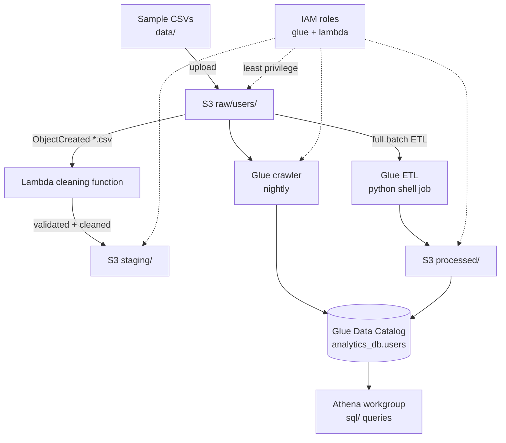

# AWS Data Pipeline — S3 + Glue + Athena + Lambda + IAM

A complete, runnable data-lake pipeline: land raw CSVs in S3, catalog them
with Glue, clean them with validated ETL rules, query them with Athena SQL,
and clean new uploads automatically with Lambda — all behind least-privilege
IAM roles. Everything runs against **moto mocks**, so no AWS account,
credentials, or spending is needed to develop and test.

> **Project statement:** developed a cloud-based data pipeline using AWS
> services such as S3, Glue, Athena, Lambda, and IAM for secure storage,
> processing, and analytics.

## Architecture



End-to-end flow:

1. A sample CSV (`data/users_*.csv`) is uploaded to `s3://<bucket>/raw/users/`.
2. An S3 event invokes the Lambda function, which validates and cleans the
   file into `staging/` (separate prefix, so the function can never
   re-trigger itself). Unreadable files are skipped with a logged reason;
   the rest of the batch still processes.
3. The Glue crawler (nightly) or the `GlueCatalog` helper registers the
   schema in `analytics_db.users`; the Glue Python-shell job (`glue/`)
   runs the full-batch ETL into `processed/`.
4. Athena runs the SQL in `sql/` against the cataloged table; results go to
   `s3://<bucket>/athena-results/`.
5. IAM roles scope every step: Lambda reads `raw/` and writes `staging/`
   only; the Glue role owns the lake prefixes plus Glue/Athena actions.

## Repository structure

```text
aws_pipeline/      # application code (config, storage, catalog, ETL, analytics, IAM, Lambda, CLI)
  config.py        # one PipelineConfig dataclass: region, bucket, prefixes, names
  storage.py       # S3DataLake: versioned + SSE-S3 + public-access-blocked bucket
  catalog.py       # GlueCatalog: database, CSV table, nightly crawler
  processing.py    # cleaning rules: trim, lowercase emails, null tokens, drop bad/dup ids
  analytics.py     # AthenaRunner: SQL builders + submit/wait/fetch + S3-side stats
  iam.py           # least-privilege Glue + Lambda policies, role creation
  lambda_handler.py# S3 ObjectCreated trigger: clean each .csv into staging/
  pipeline.py      # run_pipeline(): storage → catalog → ETL → analytics → IAM
glue/              # Glue Python Shell job reusing the package cleaning rules
sql/               # Athena example queries (01_row_counts … 04_data_quality)
data/              # small sample CSVs (messy on purpose — they exercise every rule)
infrastructure/    # CloudFormation: bucket, Glue, Lambda + trigger, IAM, Athena workgroup
tests/             # moto-mocked unittest suite (no AWS needed)
```

## Prerequisites

- Python 3.10+ (`python --version`)
- Install dependencies:

```bash
pip install -r requirements.txt
```

(`boto3`, `moto`, `pyparsing` — all installable from PyPI; nothing else required.)

## Run it

```bash
# Full test suite (mocked AWS, ~2 seconds)
python -m unittest discover -s tests -v

# End-to-end pipeline, prints a JSON summary
python -m aws_pipeline --bucket demo-lake-bucket

# Same, but with your own raw file instead of the bundled sample
python -m aws_pipeline --bucket demo-lake-bucket --input-file data/users_002.csv

# Glue job entrypoint, locally (same rules, argparse fallback)
python glue/users_etl_job.py --bucket demo-lake-bucket
```

Expected output (mocked): 1 file in, 4 rows in, 2 rows out
(empty-name row and duplicate id dropped), Athena `SUCCEEDED`,
per-city and per-domain breakdowns.

## Sample data

`data/users_001.csv` (4 rows → 2 clean) and `data/users_002.csv`
(5 rows → 5 clean) deliberately include leading/trailing whitespace,
uppercase emails, `N/A` and empty fields, and a duplicate id, so every
cleaning rule is exercised. Upload them to `raw/` for manual runs:

```bash
aws s3 cp data/users_001.csv s3://<bucket>/raw/users/users_001.csv
```

## Athena queries (`sql/`)

Files use `{db}.{table}` placeholders — substitute your Glue database/table
(or `analytics_db.users` from the defaults):

| File | Purpose |
|---|---|
| `01_row_counts.sql` | total cleaned rows |
| `02_by_city.sql` | top 10 cities |
| `03_email_domains.sql` | top 10 email domains (data-quality view) |
| `04_data_quality.sql` | rows still missing id/name (should normally be empty) |

Run in the Athena console (set the query result location to
`s3://<bucket>/athena-results/`) or via CLI:

```bash
aws athena start-query-execution \
  --query-string "$(sed 's/{db}/analytics_db/; s/{table}/users/' sql/02_by_city.sql)" \
  --result-configuration OutputLocation=s3://<bucket>/athena-results/
```

## Glue job

`glue/users_etl_job.py` is a Glue **Python Shell** job that reuses
`aws_pipeline.processing` (shipped via `--extra-py-files` as a zip of this
package), so local behavior and Glue behavior share one implementation:

```bash
aws glue create-job --name users-etl --role <glue-role-arn> \
  --command Name=pythonshell,ScriptLocation=s3://<bucket>/jobs/users_etl_job.py,PythonVersion=3.9 \
  --default-arguments '{"--extra-py-files": "s3://<bucket>/lib/aws_pipeline.zip", "--TempDir": "s3://<bucket>/tmp/"}'
aws glue start-job-run --job-name users-etl \
  --arguments '{"--bucket": "<bucket>", "--input-prefix": "raw/users/", "--output-prefix": "processed/users/"}'
```

Output keys are deterministic per input file, so reruns overwrite rather
than duplicate (idempotent).

## Lambda trigger

Deployed by `infrastructure/cloudformation.yaml`: S3 `ObjectCreated:*` on
`raw/*.csv` → `users-cleaning` function (256 MB, 60 s timeout,
`LAKE_BUCKET` env var). Test the handler locally without deploying:

```bash
python - <<'EOF'
from moto import mock_aws
from aws_pipeline import PipelineConfig
from aws_pipeline.lambda_handler import lambda_handler
from aws_pipeline.storage import S3DataLake
with mock_aws():
    cfg = PipelineConfig(bucket="demo")
    lake = S3DataLake(cfg); lake.ensure_bucket()
    key = lake.put_raw("users_001.csv", open("data/users_001.csv","rb").read())
    print(lambda_handler({"Records": [{"s3": {"object": {"key": key}}}]}, None, cfg=cfg, lake=lake))
EOF
```

## IAM and security

- No credentials, keys, tokens, or account IDs anywhere in source
  (asserted by test).
- `iam.py` builds two least-privilege policies: the Glue role owns the lake
  prefixes plus scoped Glue/Athena actions; the Lambda role gets CloudWatch
  Logs + read on `raw/` + write on `staging/` only (no delete, no
  processed-bucket access).
- S3: versioning + SSE-S3 default encryption + full public-access block
  (all asserted in tests).
- Athena results stay inside the lake bucket.

## Infrastructure (`infrastructure/cloudformation.yaml`)

One CloudFormation template mirroring `config.py` / `iam.py` /
`catalog.py` (single framework, no CDK/Terraform to install):

- S3 bucket: versioning, AES256, public-access block, lifecycle
  (abort incomplete uploads, expire old versions), `raw/*.csv` → Lambda trigger
- Glue database + CSV table + nightly crawler
- Lambda (Python 3.12, 256 MB, 60 s) + invoke permission
- Least-privilege Glue + Lambda roles (same statements as `iam.py`)
- Athena workgroup pinned to `s3://<bucket>/athena-results/`

Validate without an account (PyYAML only):

```bash
python -c "import yaml; d=yaml.safe_load(open('infrastructure/cloudformation.yaml')); print(sorted(d['Resources']))"
```

Deploy (needs credentials; nothing here deploys on its own):

```bash
aws cloudformation deploy \
  --template-file infrastructure/cloudformation.yaml \
  --stack-name data-lake-dev \
  --parameter-overrides EnvName=dev BucketName=my-data-lake-dev \
  --capabilities CAPABILITY_NAMED_IAM
```

## Expected output and sample analytics

Mocked run of the bundled sample: `{"files": 1, "rows_in": 4, "rows_out": 2}`,
Athena `SUCCEEDED`, `by_city: {London: 1, Manchester: 1}`,
`by_domain: {example.com: 2}`. `data/users_002.csv` yields 5 clean rows
including a null-email row (invalid emails are nulled, not dropped, unless
id/name are also missing).

## Troubleshooting

- `NoCredentialsError` outside tests: normal — the package creates real
  boto3 clients. Wrap calls in `moto.mock_aws()` (as tests do) or configure
  credentials.
- `EntityAlreadyExists` on roles/tables/buckets: all `ensure_*` helpers are
  idempotent — rerun safely.
- Athena `TIMEOUT` in `wait()`: increase the `timeout` argument; the default
  60 s suits small demo data.
- Lambda writing to `staging/` never retriggers itself because the S3
  trigger filters on the `raw/` prefix.

## Cleanup

No real resources are created by tests or the mocked CLI. After a real
deploy: empty the bucket first (versioned), then
`aws cloudformation delete-stack --stack-name data-lake-dev`.

## Limitations and future work

- Processed output is CSV (matches the Glue OpenCSVSerde table). Parquet
  would need `pyarrow` (not installed here) plus a table DDL change.
- Athena `stats()` recomputes aggregates from S3 because moto returns no
  result rows; against real AWS the submitted SQL is what runs.
- No Glue Spark job: the Python-shell job covers batch ETL without a Spark
  cluster to test against; a Spark variant would need a live Glue environment.
- Email delivery for pipeline alerts (e.g. SNS on Lambda failure) is not
  wired; CloudWatch Logs cover observability for now.
